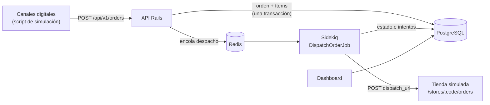
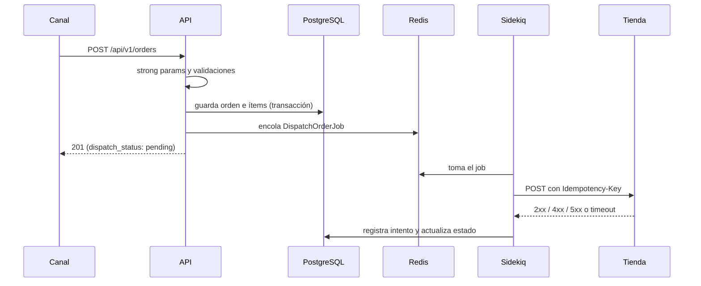
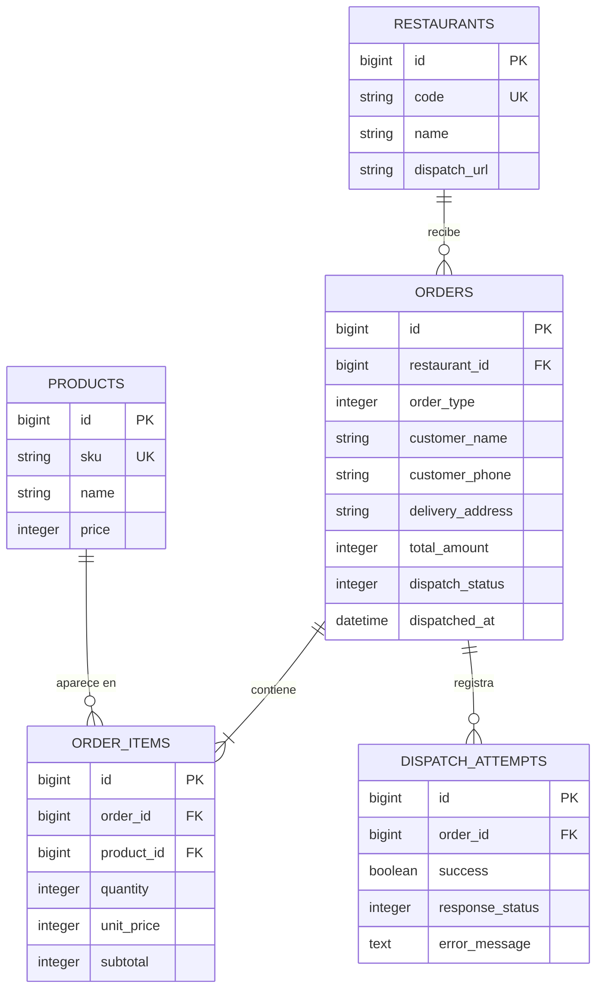

# Niu Foods · Integración y distribución de órdenes

API central en Ruby on Rails que recibe órdenes desde canales digitales, las valida, calcula su monto, las persiste en PostgreSQL y las despacha de forma asíncrona a la tienda que debe prepararlas. Incluye una tienda simulada, un script que genera órdenes y un dashboard para revisarlas.

## Stack

- Ruby 3.3.13 y Rails 8
- PostgreSQL
- Sidekiq 8 con Redis, para el despacho en segundo plano y los reintentos
- Vistas ERB sin JavaScript para el dashboard
- RSpec y WebMock para los tests

## Arquitectura



## Flujo de una orden



1. **Recepción.** `POST /api/v1/orders` recibe el JSON. Los strong params solo dejan pasar los campos esperados; cualquier otro, incluido un total enviado por el cliente, se descarta.
2. **Validación.** El modelo valida que el restaurante y los productos existan, que el tipo sea `pickup` o `delivery`, que un delivery tenga dirección, que haya al menos un producto, que las cantidades sean enteros mayores que 0, que no haya productos repetidos y el formato del teléfono. Si algo falla, responde 422 con el detalle por campo e ítem. Si el JSON está mal formado, responde 400.
3. **Cálculo del monto.** El total se calcula en el servidor con los precios de la base de datos. Cada ítem guarda su `unit_price` y su `subtotal`, de modo que un cambio de precio posterior no altera órdenes existentes.
4. **Persistencia.** La orden y sus ítems se guardan en una sola transacción. La base de datos refuerza la integridad con `NOT NULL`, claves foráneas, índices únicos y `CHECK` (cantidad positiva, montos no negativos).
5. **Encolado.** Después del commit se encola `DispatchOrderJob` y la API responde 201 con la orden en estado `pending`.
6. **Despacho.** Sidekiq envía la orden a la `dispatch_url` de su restaurante, con un header `Idempotency-Key`:
   - **2xx:** la orden pasa a `sent` y se guarda `dispatched_at`.
   - **4xx:** error permanente; la orden pasa a `failed` sin reintentar.
   - **5xx, timeout o conexión rechazada:** se reintenta hasta 3 veces con el backoff exponencial de Sidekiq. Si se agotan los reintentos, la orden pasa a `failed`.

   Cada intento, exitoso o no, queda registrado en `dispatch_attempts` con su código HTTP y su error.

## Modelo de datos



- Los montos se guardan como enteros, porque el peso chileno no usa decimales.
- `order_type` y `dispatch_status` son enums: `pickup`/`delivery` y `pending`/`sent`/`failed`.
- `order_items` tiene un índice único `(order_id, product_id)`: un producto aparece una sola vez por orden.
- `dispatch_url` vive en cada restaurante, así que el ruteo a la tienda depende de los datos y no del código.

## Requisitos

- Ruby 3.3.13 (definida en `.ruby-version`)
- PostgreSQL 12 o superior (probado con 12.22)
- Redis 7 o superior, requerido por Sidekiq 8 (probado con 8.0.6)

## Inicio rápido

```bash
git clone git@github.com:bherdocio/niufoods-orders.git
cd niufoods-orders
bundle install
bin/rails db:create db:migrate db:seed
bin/rails server            # terminal 1
bundle exec sidekiq         # terminal 2
ruby script/simulate_orders.rb 20   # terminal 3
```

Luego abre <http://localhost:3000>. Si tu PostgreSQL no tiene el rol `niufoods`, revisa la sección Instalación.

## Instalación

```bash
git clone git@github.com:bherdocio/niufoods-orders.git
cd niufoods-orders
bundle install
```

Por defecto la app se conecta a PostgreSQL en `localhost:5432` con el usuario `niufoods` y la contraseña `niufoods`. Puedes crear ese rol así:

```bash
sudo -u postgres psql -c "CREATE ROLE niufoods SUPERUSER LOGIN PASSWORD 'niufoods';"
```

En macOS con Homebrew no existe el usuario `postgres`; puedes usar tu propio usuario: `DB_USER=$(whoami) DB_PASSWORD= bin/rails db:create db:migrate db:seed` (exporta las mismas variables al levantar el servidor y Sidekiq).

Si levantas el servidor en otro puerto, define `STORE_BASE_URL` (por ejemplo, `STORE_BASE_URL=http://localhost:4000`) antes de correr los seeds, porque ahí se guarda la URL de despacho de cada tienda.

O usar tus propias credenciales con las variables `DB_HOST`, `DB_PORT`, `DB_USER` y `DB_PASSWORD`. Luego:

```bash
bin/rails db:create db:migrate db:seed
```

Los seeds cargan los 3 restaurantes y los 10 productos del enunciado con sus mismos IDs, para que el payload de referencia funcione tal cual. Se pueden ejecutar varias veces sin duplicar datos.

## Ejecución

Se necesitan dos procesos, cada uno en su terminal:

```bash
bin/rails server
```

```bash
bundle exec sidekiq
```

El dashboard queda en <http://localhost:3000>.

| Variable | Por defecto | Uso |
|---|---|---|
| `REDIS_URL` | `redis://localhost:6379/1` | Redis de Sidekiq. Usa la base 1 para no mezclar jobs con otros proyectos. |
| `STORE_BASE_URL` | `http://localhost:3000` | Base de la `dispatch_url` que los seeds asignan a cada restaurante. |
| `STORE_FAILURE_RATE` | `0` | Probabilidad (0 a 1) de que la tienda simulada responda 503. |
| `DB_HOST`, `DB_PORT`, `DB_USER`, `DB_PASSWORD` | `localhost`, `5432`, `niufoods`, `niufoods` | Conexión a PostgreSQL. |

## API

### `POST /api/v1/orders`

```bash
curl -X POST http://localhost:3000/api/v1/orders \
  -H "Content-Type: application/json" \
  -d '{
    "restaurant_id": 2,
    "order_type": "delivery",
    "customer": { "name": "Ana Pérez", "phone": "+56912345678" },
    "delivery_address": "Av. Providencia 1234, Santiago",
    "items": [
      { "product_id": 1, "quantity": 2 },
      { "product_id": 5, "quantity": 1 }
    ]
  }'
```

Respuesta `201 Created`:

```json
{
  "id": 2,
  "restaurant": { "id": 2, "code": "LCON", "name": "Niu Foods Las Condes" },
  "order_type": "delivery",
  "customer": { "name": "Ana Pérez", "phone": "+56912345678" },
  "delivery_address": "Av. Providencia 1234, Santiago",
  "total_amount": 22470,
  "dispatch_status": "pending",
  "created_at": "2026-10-28T18:09:11.147-03:00",
  "items": [
    { "product_id": 1, "sku": "SKU-001", "name": "Niu Roll Salmón", "quantity": 2, "unit_price": 8990, "subtotal": 17980 },
    { "product_id": 5, "sku": "SKU-005", "name": "Gyozas de Pollo x5", "quantity": 1, "unit_price": 4490, "subtotal": 4490 }
  ]
}
```

Respuesta `422 Unprocessable Content` (orden inválida):

```json
{
  "errors": [
    "Restaurant must exist",
    "Order items[0] product must exist",
    "Order items[0] quantity must be greater than 0",
    "Customer name can't be blank",
    "Delivery address can't be blank",
    "Order items contiene productos repetidos"
  ]
}
```

| Código | Cuándo |
|---|---|
| 201 | Orden creada y despacho encolado |
| 422 | Falla alguna validación; no se guarda nada |
| 400 | El cuerpo no es un JSON válido |

## Tienda simulada

`POST /stores/:code/orders` recibe el payload despachado y responde como lo haría el sistema de una tienda:

- **200** si la tienda existe y la orden trae su `id`; deja un registro en el log del servidor.
- **404** si el código de tienda no existe.
- **422** si el payload no trae `id`.
- **503** con la probabilidad definida en `STORE_FAILURE_RATE`, para probar los reintentos.

Vive en la misma aplicación por simplicidad, pero se le habla por HTTP como a un servicio externo. En producción sería un servicio aparte.

Para ver los reintentos en acción:

```bash
STORE_FAILURE_RATE=0.3 bin/rails server
```

## Script de simulación

```bash
ruby script/simulate_orders.rb [cantidad] [url_api]
ruby script/simulate_orders.rb 20
```

Es Ruby puro (solo librería estándar) y actúa como un canal externo que envía órdenes por HTTP:

- Genera órdenes con restaurante y tipo al azar, de 1 a 4 productos distintos y cantidades de 1 a 3. Agrega dirección solo a los delivery.
- Una de cada 5 órdenes es inválida a propósito, rotando entre delivery sin dirección, cantidad 0 y producto inexistente, para mostrar los 422.
- Imprime el resultado de cada orden y un resumen. Termina con código 0 si no hubo errores de conexión ni respuestas inesperadas, y con 1 en caso contrario.
- Con `SEED=123` la secuencia de órdenes es reproducible.

```text
#001 OK    orden 11 · PROV · delivery · $54.920
#002 OK    orden 12 · LCON · delivery · $41.330
#005 422   Delivery address can't be blank
#010 422   Order items[0] quantity must be greater than 0
#015 422   Order items[0] product must exist

Resumen: 16 creadas, 4 rechazadas por validación, 0 con error
```

## Dashboard

- **Filtros** por rango de fechas, tienda y estado de despacho. Las fechas y la tienda afectan a todo el dashboard (indicadores, gráficos y listado); el estado filtra solo el listado, para que las tarjetas sigan mostrando el total de cada estado.
- **Tarjetas por estado** (Pendiente, Enviado y Error); cada una filtra el listado manteniendo las fechas y la tienda elegidas.
- **Indicadores de ventas:** ventas totales y ticket promedio (ventas totales divididas por la cantidad de órdenes). Consideran todas las órdenes del período, sin importar su estado de despacho.
- **Gráficos:**
  - Ventas en el tiempo: por hora si el período abarca hasta 24 horas y por día si es mayor, con ceros en los tramos sin ventas.
  - Ventas por tienda, con monto y cantidad de órdenes.
  - Los 5 productos más vendidos por unidades.
- **Listado** con número, tienda, monto, tipo (Retiro o Delivery), fecha de creación y estado (Pendiente, Enviado o Error), paginado de a 25.
- **Detalle de cada orden** con los datos del cliente, los productos y el historial de intentos de despacho.
- **Botón para reintentar** el despacho de órdenes con error.
- Se recarga cada 30 segundos para ver los cambios de estado.

Los gráficos se dibujan con HTML y CSS desde el servidor, sin JavaScript ni librerías externas.

## Tests

```bash
bundle exec rspec
```

Los tests no necesitan Redis ni red: Sidekiq corre en modo `fake` y WebMock simula las respuestas de la tienda. Cubren:

- El cálculo del total con precios de la base, ignorando el total del cliente, y que el precio no cambie si el producto cambia después.
- Las validaciones de la orden.
- La API: 201 con el despacho encolado, 422 sin persistir nada y 400 con JSON inválido.
- El despacho: 2xx, 4xx sin reintento, 5xx y timeout reintentables, y el header `Idempotency-Key`.
- El job: no reenvía órdenes ya enviadas y marca error al agotar los reintentos.
- Los filtros del dashboard: rango de fechas inclusivo, fechas invertidas o inválidas, tienda, y estado aplicado solo al listado.
- Las estadísticas: ventas por tienda, productos más vendidos, ventas totales, ticket promedio y ventas en el tiempo por hora y por día.
- El dashboard: listado, filtros, gráficos, detalle y reintento manual.

El CI de GitHub Actions ejecuta RuboCop, Brakeman y la suite de RSpec en cada push.

## Decisiones técnicas

- **Service objects.** `Orders::Create` traduce el payload al modelo y encola el despacho; `Orders::Dispatch` concentra la comunicación con la tienda. Los controladores quedan delgados.
- **El total lo calcula el modelo** con los precios de la base, solo al crear la orden. Los ítems guardan el precio del momento (snapshot).
- **`ActionController::API` para la API**, sin CSRF ni lo que solo necesitan las vistas, y con `wrap_parameters false` para recibir el payload tal como viene en el enunciado.
- **Enums con `validate: true`**, para que un `order_type` inválido sea un 422 y no una excepción.
- **Productos repetidos se rechazan con 422**, en vez de sumar sus cantidades. Lo valida el modelo y lo refuerza un índice único.
- **Se encola después del commit.** Si se encolara dentro de la transacción, el job podría correr antes de que la orden exista.
- **Despacho idempotente.** El job no reenvía órdenes ya enviadas, y el header `Idempotency-Key` permite a la tienda descartar duplicados.
- **4xx no se reintenta y 5xx sí.** Un 4xx indica un problema que no se arregla reintentando; un 5xx o un timeout suelen ser transitorios.
- **`Sidekiq::Job` nativo en vez de ActiveJob**, para usar directamente las opciones de reintento y el callback de reintentos agotados.
- **Tabla `dispatch_attempts`.** Da trazabilidad de cada intento y alimenta el detalle del dashboard.
- **Dashboard con ERB y sin JavaScript.** El enunciado permite hacerlo en Rails, y así no hay build de frontend. Los gráficos también son HTML y CSS generados en el servidor.
- **Filtros y estadísticas en objetos separados.** `Orders::DashboardFilter` interpreta los parámetros y arma las consultas; `Orders::DashboardStats` calcula los indicadores. Las sumas por tienda y por producto se hacen en PostgreSQL con `GROUP BY`.

## Notas de desarrollo

Problemas que encontré durante el desarrollo y cómo los resolví:

- **Errores genéricos de los ítems.** Con `index_errors: true`, la API seguía respondiendo "Order items is invalid". Rails solo copia los errores de cada ítem a la orden si la asociación tiene `autosave: true`. Con eso, el error dice qué ítem falló y por qué.
- **Orden de los callbacks.** El `before_validation` de la orden corre antes que el de sus ítems, así que el total salía en 0. `calculate_total` asigna primero los precios de cada ítem y después suma.
- **El snapshot de precios no se mantenía.** Un test mostró que, al actualizar el estado de despacho, Rails volvía a validar, recalculaba los precios con el valor actual del producto y los guardaba. Limitar los callbacks a la creación (`on: :create`) lo corrigió.
- **Redis compartido con otro proyecto.** Sidekiq tomó jobs de otra aplicación local que usaba la misma base de Redis. Ahora el proyecto usa la base 1 por defecto.
- **El gráfico ignoraba el rango elegido.** Al principio, el eje del gráfico de ventas en el tiempo iba de la primera a la última orden encontrada, así que elegir un rango más amplio no mostraba los días sin ventas. Ahora usa el rango del filtro y corta en el momento actual.
- **Versiones.** Brakeman advirtió que Rails 7.2 ya no tiene soporte, así que actualicé a Rails 8. Además, los runners de GitHub solo traen el último parche de Ruby 3.3, así que pasé de 3.3.7 a 3.3.13.

## Limitaciones conocidas

- **Redis caído al crear una orden.** La orden se guarda en `pending`, pero su job no se encola y no hay una reconciliación automática. Se puede reencolar a mano:

  ```bash
  bin/rails runner 'Order.pending.find_each { |o| DispatchOrderJob.enqueue(o) }'
  ```

- **Sin autenticación** en la API ni en el dashboard.
- **Sin idempotencia en la creación.** Si un canal reintenta el mismo `POST`, se crea una orden duplicada.
- **Mensajes de error en inglés**, que son los que trae Rails por defecto.
- **La tienda simulada vive en la misma aplicación.**
- **El gráfico de ventas en el tiempo agrupa en Ruby.** Es suficiente para este volumen; con más datos lo haría en SQL con `date_trunc`.

## Qué haría en producción

- Patrón outbox o una tarea periódica que reencole las órdenes pendientes, para no perder despachos si Redis falla.
- Autenticación por canal (tokens o API keys) y límites de tasa.
- Idempotencia en la creación de órdenes, con una referencia externa única por canal.
- La tienda como servicio separado, con timeouts configurables por tienda y un circuit breaker.
- Alertas sobre los jobs muertos de Sidekiq y métricas de despacho.
- Mensajes de error en español con i18n y actualizaciones en vivo en el dashboard.

## Ramas

- `main`: la entrega.
- `rails-7.2`: estado del proyecto antes de actualizar a Rails 8, solo como referencia. Su CI falla porque usa Ruby 3.3.7, que ya no está disponible en los runners de GitHub.

## Uso de IA

Usé IA (Claude) como apoyo para consultas, revisión de código, ejemplos y el borrador de esta documentación. Revisé, probé y ajusté cada parte, y las decisiones de diseño quedan explicadas arriba.
